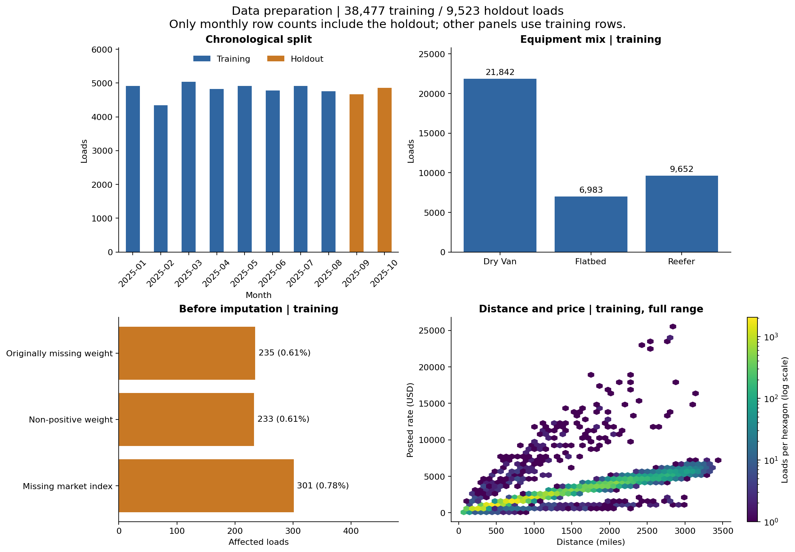
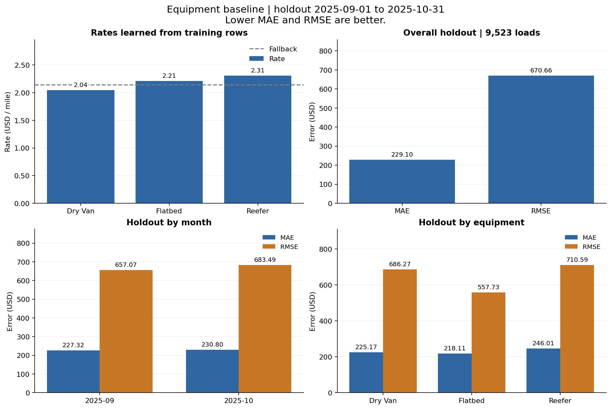
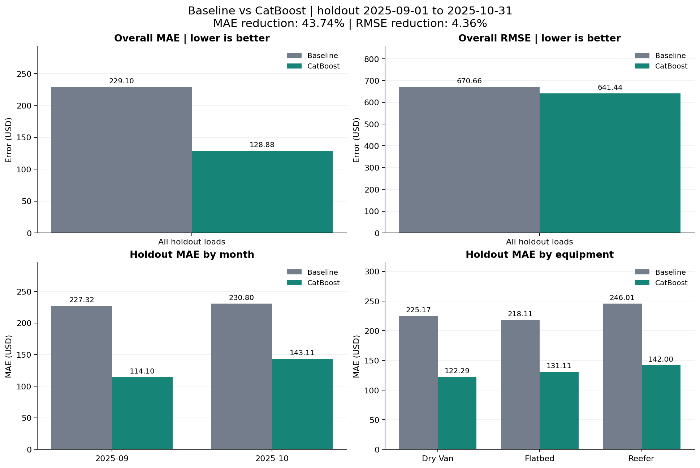

# Freight Rate Prediction Challenge

See `freight-rate-ml-assessment.pdf` for the assessment instructions.

## What to do

1. Train and validate your model using `data/train-test.csv`.
2. Predict every load in `data/validation.csv`. Each load has a unique `load_id`.
3. Fill the matching `predicted_rate` values in `data/validation-predictions-template.csv` and save it as `validation_predictions.csv`.
4. Predict every row in `data/december-chart-inputs.csv` and save the completed copy as `submission/december_predictions.csv`.
5. Install the scorer requirements and run:

```bash
python -m pip install -r requirements.txt
python score.py --predictions validation_predictions.csv --december-predictions submission/december_predictions.csv
```

The scorer validates both files and creates `scorer_results/candidate_december.png`.

## Submit

- GitHub repository containing your code, dependencies, and run instructions
- `validation_predictions.csv`
- PDF or DOCX report containing your validation, data split approach and `candidate_december.png`
- 2-3 minute Loom link

# Freight Rate Prediction Challenge - Solution

## Run the baseline

Use Python 3.10 or later. From the repository root, run:

```bash
python -m pip install -r requirements.txt
python prepare_data.py
python baseline.py
```

These commands automatically save PNG figures as well as the baseline's CSV and
JSON results.

`prepare_data.py` splits the labeled data at September 1, 2025: January-August
provides 38,477 training rows, and September-October provides 9,523 holdout rows.
It marks non-positive weights as invalid, converts them to missing values, and
fills missing weights and market-index values with training-only medians. Missing
and invalid-value flags are retained. The original CSV files are not modified.

It also saves `outputs/preparation/figures/data_overview.png`, containing:

- Monthly row counts showing the training/holdout split.
- Training equipment counts.
- Training missing/invalid-value counts before imputation. Originally missing
  weights and non-positive weights are counted separately.
- Training distance versus posted rate, using all training rows and the full
  price range. Hexagon colors show load counts on a logarithmic scale.

Only the monthly row-count panel includes holdout rows. The other panels use
training data. `prepare_data.py` does not save processed CSV copies; the modeling
scripts call its loading/preparation functions directly.

Reference data overview:



The baseline uses only equipment and distance. For each equipment type, it learns
the median of `posted_rate / distance` from training rows. A prediction is that
median multiplied by the load's distance. Missing or unseen equipment uses the
overall training median rate per mile. Weight and market-index preprocessing is
available for later models; those fields do not affect this baseline.

`baseline.py` reports MAE and RMSE in dollars and writes these files:

- `outputs/baseline/metrics.json`: split details, learned rates, preprocessing
  medians, overall metrics, and metrics by month and equipment.
- `outputs/baseline/holdout_predictions.csv`: IDs, inputs used by the baseline,
  actual prices, predicted prices, and errors for the 9,523 labeled holdout rows.
- `outputs/baseline/metrics_by_month.csv`: September and October results.
- `outputs/baseline/metrics_by_equipment.csv`: results for each equipment type.
- `outputs/baseline/figures/baseline_summary.png`: learned equipment rates,
  overall holdout MAE/RMSE, and errors by month and equipment.

Reference baseline figure:



MAE is the average absolute price error. RMSE squares errors before averaging and
taking the square root, so it gives greater weight to large errors. The baseline
is deterministic and does not require a random seed.

These are local holdout results. They are not predictions for the 12,000-row
submission file. The baseline does not use `data/validation.csv` or
`quote_signal`, and it does not generate the December submission chart.

For later model tuning, use earlier chronological splits within January-August.
Keep September-October for final local evaluation. The optional `--data`,
`--cutoff`, and `--output-dir` arguments select the input file, split date, and
result directory for both `prepare_data.py` and `baseline.py`. Their default
directories are `outputs/preparation/` and `outputs/baseline/`, respectively.
Every input row on or after the cutoff belongs to that run's holdout.

To redraw only the baseline figure from an existing completed run:

```bash
python plot_results.py --stage baseline
```

## Train CatBoost

Install the additional dependency and run the model-selection script:

```bash
python -m pip install -r requirements-catboost.txt
python train_catboost.py
```

The default run uses CatBoost 1.2.8 on CPU, four threads, and random seed 42.
It compares tree depths 6 and 8 with MAE loss and learning rate 0.05. Each
candidate can train up to 1,200 trees, with early stopping after 80 iterations
without improvement on its internal validation window.

The three model-selection folds are:

| Training dates | Validation dates | Training rows | Validation rows |
| --- | --- | ---: | ---: |
| January-February 2025 | March-April 2025 | 9,255 | 9,855 |
| January-April 2025 | May-June 2025 | 19,110 | 9,696 |
| January-June 2025 | July-August 2025 | 28,806 | 9,671 |

Each fold fits its own preprocessing using that fold's training rows. The chosen
depth has the lowest validation-row-weighted mean absolute error across the
folds. Its final tree count is the median of its three best tree counts.
The selection is written to `selection.json` before the selected configuration
is fitted on all January-August rows. September-October is evaluated afterward;
it is not passed to CatBoost for early stopping or setting selection.

Features include pickup, delivery, equipment, the directed pickup-delivery lane,
distance and its logarithm, cleaned weight and its missing/invalid flags,
coordinates and coordinate differences, and calendar features. City and lane
columns are passed to CatBoost as categorical features. `load_id` and the target
price are not features. `quote_signal` is excluded because its relationship with
price changes direction within the development period. `market_index` is also
excluded to support the reduced input schema supplied for the December chart.

The feature builder learns city coordinates from training rows only. It uses
coordinates supplied with a load when present, and otherwise fills them from
that lookup. This supports the December chart's Lexington and Fort Wayne inputs
without inventing market-index or quote-signal values. A completely unknown city
without supplied coordinates retains missing numeric coordinate values. Missing
or non-positive weights use the training median, with flags retained. Predictions
are floored at $0.01 to enforce positive prices.

Results are saved under `outputs/catboost/`:

- `cv_results.csv` and `selection.json`: chronological model-selection results.
- `model.cbm` and `feature_state.json`: the fitted model and preprocessing state.
- `metrics.json`: model settings, data hash, package versions, holdout metrics,
  and the comparison with the equipment baseline.
- `holdout_predictions.csv`: actual and predicted prices for the labeled holdout,
  with the baseline predictions alongside the CatBoost predictions.
- `metrics_by_month.csv`, `metrics_by_equipment.csv`, and
  `feature_importance.csv`: error breakdowns and model feature importance.

The same run automatically creates four figures under
`outputs/catboost/figures/`. The links below open copies from the reference run:

| Figure | What it shows |
| --- | --- |
| [cv_mae.png](docs/figures/cv_mae.png) | Baseline and depth-6/depth-8 validation MAE in each chronological fold; selected settings and weighted CV MAE |
| [holdout_comparison.png](docs/figures/holdout_comparison.png) | Baseline versus CatBoost overall MAE/RMSE, monthly MAE, and equipment MAE |
| [prediction_diagnostics.png](docs/figures/prediction_diagnostics.png) | Full-range predicted versus actual prices and the percentage of loads above each absolute-error threshold |
| [feature_importance.png](docs/figures/feature_importance.png) | All feature-importance scores from the January-August fitted model |

The figures are derived from the saved CSV/JSON files. Those files remain
available for exact values and reproducibility. The model and preprocessing
files remain necessary for prediction; figures cannot replace them.

The saved model is the January-August evaluation model. Final submission requires
refitting the selected configuration and preprocessing on all January-October
rows before predicting the 12,000 final loads and the fixed December inputs.

The reference run on the supplied data selected depth 6 and 503 trees. Its
September-October results were:

| Model | MAE (USD) | RMSE (USD) |
| --- | ---: | ---: |
| Equipment rate-per-mile baseline | 229.10 | 670.66 |
| Selected CatBoost model | 128.88 | 641.44 |

This is a 43.74% reduction in MAE and a 4.36% reduction in RMSE. These are
internal holdout results; the 12,000 final loads do not have provided labels.



The diagnostic figure retains large errors rather than clipping them. Its
error-tail panel uses a logarithmic percentage axis and an error axis that is
linear up to $10, then logarithmic. A lower curve means fewer loads have errors
at least as large as the threshold. This helps explain why the improvement in
RMSE is smaller than the improvement in MAE: large errors remain for both models.

The optional `--data`, `--output-dir`, `--max-iterations`, `--seed`, and `--threads`
arguments control the run. The model-selection dates and the September 1 holdout
boundary are fixed to the assessment's 2025 data. Feature importance describes
this fitted model and is not a measure of causal effects.

To create or refresh figures after an existing completed run, without fitting
CatBoost again:

```bash
python plot_results.py --stage catboost
```

To refresh all six figures from your existing results:

```bash
python prepare_data.py
python plot_results.py
```

`plot_results.py` defaults to both baseline and CatBoost. It only needs
`requirements.txt`, reads the saved evaluation CSV/JSON files, and writes PNGs.
It does not load the model, change metrics or predictions, or run model selection.
If a result file is missing, run its corresponding evaluation script first.
For custom result directories, use `--baseline-dir` and `--catboost-dir`:

```bash
python plot_results.py --stage catboost --catboost-dir outputs/my_catboost_run
```

The README displays reference copies under `docs/figures/`. After a
new complete run, update the reference copies deliberately if you want the README
to show that run:

```bash
mkdir -p docs/figures
cp outputs/preparation/figures/*.png outputs/baseline/figures/*.png outputs/catboost/figures/*.png docs/figures/
```

These evaluation figures can support the report and Loom walkthrough. The
required December chart is still produced separately by `score.py` below.

## Generate final predictions and the December chart

After `python train_catboost.py` has completed, run:

```bash
python make_submission.py
```

The script reads the selected settings and data hash from `outputs/catboost/`.
It verifies that the input training file is the same one used for evaluation,
then refits the selected model and feature builder on all 48,000 labeled loads
from January-October. For the reference run this is depth 6, 503 trees, and seed
42, with four CPU threads. The earlier holdout metrics are not recalculated on
this refitted model because those holdout rows are now included in training.

It predicts every load in `data/validation.csv`, matches predictions to the
template by `load_id`, and writes `validation_predictions.csv` with exactly the
two required columns. It also predicts the 31 fixed December inputs and writes
a completed copy to `submission/december_predictions.csv`. Prices are rounded
to cents. The original input CSV files are preserved.

The script then runs the provided `score.py` on these saved CSV files. The scorer
checks the output formats and generates `scorer_results/candidate_december.png`.
Passing it does not measure final accuracy: the 12,000 final loads have no
provided target prices.

| File | Contents |
| --- | --- |
| `validation_predictions.csv` | Required final predictions for all 12,000 load IDs |
| `submission/december_predictions.csv` | Completed seven-column December input file |
| `scorer_results/candidate_december.png` | Required chart produced by the supplied scorer |
| `submission/run_summary.json` | Final training settings, data hashes, output counts, and scorer result |
| `outputs/final/model.cbm` | Model refitted on all labeled loads |
| `outputs/final/feature_state.json` | Weight median and coordinate lookup refitted on all labeled loads |

The two prediction CSV files, chart, and run summary from the reference run are
included in the submission branch. The model files remain generated outputs and
can be reproduced with the command above. A fresh checkout needs the dependency
installation and `python train_catboost.py` first to create the selection files.

To run the provided checker again without retraining:

```bash
python score.py --predictions validation_predictions.csv --december-predictions submission/december_predictions.csv
```
